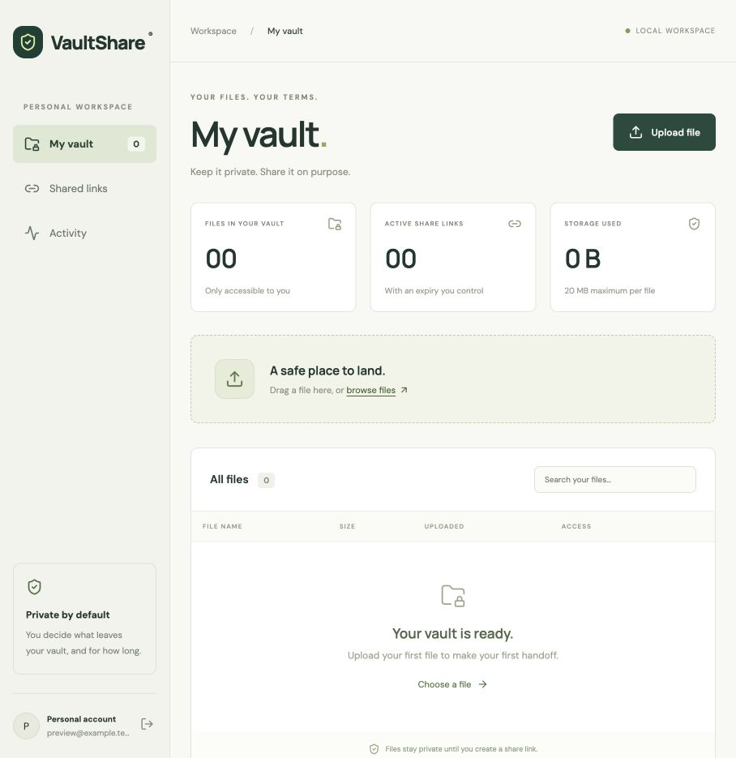
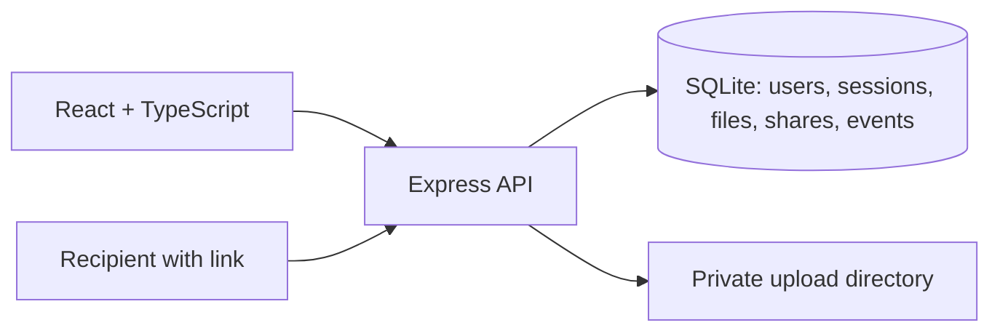

# VaultShare

A full-stack portfolio project for private file storage and expiring sharing links. Built with React, TypeScript, Express, and SQLite. Runs locally without a cloud account.



## Run locally

Requires Node.js 24 or newer.

```sh
npm install
npm run dev
```

Open **http://localhost:5173** (use localhost, not 127.0.0.1). Create your own account with any valid email format and a password of at least 12 characters. Email delivery and verification are not implemented. The preview account is only a local test account; sign out to create your own.

```sh
npm test
npm run build
```

To serve the built app locally:

```sh
APP_ORIGIN=http://localhost:3001 npm start
```

Open http://localhost:3001. Default server binding is loopback only. `APP_ORIGIN` must match the browser origin exactly. `PORT` and `DATA_DIR` are optional server settings. Development runs Vite on 5173 and the API on 3001; both should be free before starting.

## Working features

- Account creation and sign-in; sessions expire after 24 hours.
- Private file upload, search, download, and permanent deletion (20 MB per file).
- Share links expiring in 1 hour, 24 hours, or 7 days.
- Owner-only link revocation; anonymous recipient download page.
- Activity log for uploads, deletion, link creation/revocation, and public download requests.
- Responsive dashboard, empty states, upload progress state, and error feedback.
- Persistent local storage across restarts.

## Architecture



Uploaded files live outside the static website in `data/uploads/`, under generated UUIDs rather than user-supplied paths. Metadata and audit records live in `data/vault.db`. Keep the whole data directory together when backing up. It is ignored by Git, as are dependencies and build output.

## Security decisions

- Passwords use asynchronous scrypt with individual random salts. Passwords are never stored in plaintext.
- Session and share tokens are 256-bit random values. Only SHA-256 digests are stored in the database.
- Sessions use HttpOnly, SameSite=Strict cookies; Secure is enabled with NODE_ENV=production.
- Every private file and link operation checks the authenticated owner on the server.
- All writes require the configured Origin header. No permissive CORS configuration.
- SQL values use bound parameters. File names are cleaned and files use server-generated storage names.
- Expiry and revocation are enforced on both recipient metadata and download routes.
- Helmet headers, no-store API responses, request limits, and strict upload limits reduce exposure.
- Downloads use attachment disposition. The activity log records download requests, not proof that a recipient completed a download.
- Raw share URLs are returned once and excluded from activity records. Anyone possessing a live URL can download; there is no recipient identity verification.

The integration test exercises unauthenticated rejection, hostile origins, password validation, cross-account isolation, valid downloads, expiry, revocation, hashed credentials, logout, reauthentication, persistence, and cascading share deletion.

## Scope and next milestones

This is a local portfolio MVP, not an audited production file service. Files are not encrypted at rest by the app, uploads are not malware-scanned, and there is no account-wide storage quota. Avoid sensitive files in the demo.

Before public hosting, add HTTPS, durable object storage, a PostgreSQL adapter/migrations, total storage quotas, malware scanning/quarantine, email verification and password reset, and operational monitoring/backups. Rate limiting currently uses one process's memory and should use a shared store if scaled. Session cleanup happens at sign-in; add scheduled cleanup for expired records. Add a cleanup task for orphaned uploads after an interrupted write, and transactions/reconciliation for deletion failure cases. A public service also needs per-account resource controls, stronger abuse protection, and careful security review.

SQLite keeps setup small for this version; the SQL ownership and relationship model can be migrated to PostgreSQL as a follow-up. There are no roles beyond file owner and anonymous link holder.

## Portfolio talking points

Explain the difference between authentication and ownership checks, why token digests are stored, how expiration is enforced server-side, why uploads are outside the static directory, and what changes when moving from one local process to a hosted service. Demonstrate a share link working, then revoke it and show the recipient's access disappearing.

References: [Express security guidance](https://expressjs.com/en/advanced/best-practice-security/) and [Node SQLite documentation](https://nodejs.org/api/sqlite.html).
